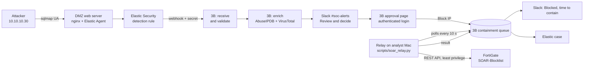
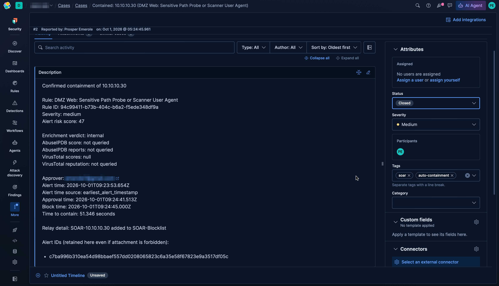

# SOAR Auto-Containment: Elastic Alert to FortiGate Block in 51 Seconds

A human-in-the-loop SOAR playbook. An Elastic Security detection is enriched with threat intelligence, sent to Slack for an analyst decision, and on approval the attacker's IP is blocked on a FortiGate firewall by an on-prem relay. An Elastic case is then opened with the full timeline.

Measured on a live attack in my home lab: **51.3 seconds from alert to firewall block**, of which **3.5 seconds was automation**. The other 47.9 seconds was the human decision.

**Stack:** Elastic Security · 3B (Tines) · AbuseIPDB · VirusTotal · Slack · FortiGate 8.0 REST API · Python · Elastic Cases API

## Results

| | |
|---|---|
| Alert to block (time to contain) | **51.3 s** (run 2), 67.4 s (run 1) |
| Approval to block (automation only) | **3.5 s** (run 2), 8.0 s (run 1) |
| Share of containment time spent on the human decision | **93%** |
| Attacker request before / after block | `HTTP 200` / timeout (`HTTP 000`) |
| Case created in Elastic | Yes, with enrichment, approver, timestamps and alert IDs |
| Inbound ports opened on the lab network | **0** |

## How it works



1. **Detect.** The Elastic rule *DMZ Web: Sensitive Path Probe or Scanner User Agent* (from the [Sigma library](https://github.com/Emerole7/sigma-detection-library)) fires on a scanner user agent hitting the DMZ web server.
2. **Receive.** A rule action posts a summary of the alerts to a 3B webhook. The URL carries a platform-generated `external_id` secret, and the step validates the payload shape before anything else runs.
3. **Enrich.** Each unique source IP is checked against AbuseIPDB and VirusTotal and given a verdict: `malicious`, `suspicious`, `clean` or `internal`. Private (RFC1918) addresses skip both lookups, and lookup errors fail the step instead of defaulting to "clean".
4. **Decide.** Clean IPs are only logged. Anything else posts a containment request to Slack with the enrichment, alert details, a Kibana link and a **Review and decide** button. The button opens a 3B page that requires login, which records the analyst's verified identity, the decision and a UTC timestamp. Requests time out to Dismiss after 30 minutes.
5. **Contain.** **Block IP** creates a queued job. A Python relay inside the lab polls the queue, adds `SOAR-<ip>` to the FortiGate address group `SOAR-Blocklist`, reads the group back to verify, and reports the result.
6. **Record.** 3B updates the Slack message with who blocked what and the time to contain, and opens an Elastic Security case with the full timeline.

## Timeline of a real containment (run 2)

| Stage | Time (UTC) | Duration |
|---|---|---|
| Attack sent from 10.10.10.30 | 09:21:57 | |
| Elastic alert created | 09:23:53.654 | 1 min 57 s (rule runs every 5 min) |
| Analyst clicked Block IP | 09:24:41.513 | **47.9 s** human decision |
| FortiGate block confirmed by relay | 09:24:45.000 | **3.5 s** automation |
| **Time to contain (alert to block)** | | **51.3 s** |

Run 1 for comparison: 59.4 s decision and 8.0 s execution, for 67.4 s total. The relay polls every 10 seconds, so execution time ranges from about 1 to 11 seconds depending on where in the poll cycle the approval lands.

**Takeaway:** once a human approves, the block lands in seconds. Further gains come from the detection schedule (five minutes) and the decision time, not the automation. The next step would be auto-blocking IPs with a `malicious` verdict above a confidence threshold, keeping human approval for `internal` and `suspicious`.

## Security design

| Decision | Why |
|---|---|
| **Pull-based relay** instead of exposing the FortiGate | 3B cannot reach the lab, and the lab should not accept inbound connections. The relay only makes outbound HTTPS calls. |
| **Least-privilege FortiGate API user** | Profile `soar-api` has *Firewall Address: read/write* and nothing else. The API user is restricted to one trusted host, the analyst Mac. |
| **Relay guardrails** | Rejects non-IPv4, loopback, multicast and reserved addresses, and refuses to block the relay host, the firewall and the DMZ server even if the queue asks. Blocks are idempotent and verified by reading the group back. |
| **Human approval with verified identity** | The approval page requires a 3B login. Its form token is bound to the request and the logged-in user, and expires. |
| **Fail closed** | Unverifiable Slack callbacks get a 401. Enrichment errors fail the step instead of marking an IP clean. A failed case creation never undoes a block. |
| **Least-privilege Elastic API key** | The `soar-cases` role grants Cases *All* in one space and read on the alerts index only. The key expires after 30 days. |
| **Secrets kept out of code and Git** | API keys live in 3B connectors. The FortiGate token and queue URL live in `private/*.env` (mode 600, gitignored). The Elastic webhook secret was rotated after a partial value appeared in a screenshot. |

## Findings

### 1. Slack button signatures could not be verified, so approval moved to an authenticated page
The first design used native Slack buttons. Slack signs each callback with HMAC-SHA256, but 3B step code cannot read a connector secret to verify it, and the Slack connector offers no inbound trigger. Without verification, anyone holding the callback URL could forge a "Block IP" click. The receiver was left failing closed (401 on every callback), and approval moved to a 3B page that requires login. The Slack message keeps all the context and links to that page. The trade-off is one extra click in exchange for a verified identity.

### 2. Home router threat protection silently blocked the approval page
The approval link returned `ERR_CONNECTION_REFUSED`, while the same URL answered normally from outside the network. Troubleshooting steps:

- **curl with the correct IP forced:** the TCP connection opened, but the TLS Client Hello got no reply. That pattern means filtering on the TLS server name (SNI).
- **traceroute and ARP:** the gateway `192.168.40.1` had a randomized MAC and handed off straight to the ISP, which ruled out the lab FortiGate.

The cause was the home router's threat protection classifying the new `*.3b.run` domain as phishing. The fix was a single-domain allowlist rather than turning protection off.

### 3. The FortiGate eval license caps the VM at three firewall policies
A separate deny policy was rejected with "maximum number of firewall policies reached". Containment instead uses source negation on the existing `LAN-to-DMZ-web` allow policy: `srcaddr "SOAR-Blocklist"` with `srcaddr-negate enable`, meaning allow everyone except the blocklist. This widens the source from `LAN-net` to "not blocklisted", but the policy only matches traffic arriving on the LAN port, and reverse-path checks drop off-subnet sources there. Production would use a dedicated deny policy above the allow rule.

### 4. Attaching the alert to the case failed with 403, and the fallback held
Case creation succeeded, but attaching the alert returned `Unauthorized by "siem" to get "siem.queryRule"`. Elastic checks Security rules read access before linking an alert to a case, and the least-privilege key only had Cases access. Because the workflow had already written the alert IDs into the case description, the case stayed complete and Slack showed a warning. The fix is to add *Security: Read* to the `soar-cases` role and issue a new key, since API keys freeze their privileges when created.

### 5. Python on macOS could not verify any HTTPS certificate
The relay reached the FortiGate but failed on 3B with `CERTIFICATE_VERIFY_FAILED`, because python.org builds for macOS do not use the system certificate store. The fix keeps verification on by loading the `certifi` CA bundle, instead of disabling verification. The FortiGate call skips verification only because the lab firewall uses its factory self-signed certificate (see Limitations).

### 6. Two Slack messages for one alert
The detection rule still had the plain Slack action from the [Elastic SIEM lab](https://github.com/Emerole7/elastic-siem-lab), so each alert produced a notification in one channel and an actionable request in another. 3B now owns Slack for this rule.

## Screenshots

| | |
|---|---|
| Enrichment connectors | [01](docs/screenshots/01-3b-connectors.png) |
| 3B workflow and run timeline | [02](docs/screenshots/02-3b-workflow-runs.png) |
| Elastic webhook connector test | [03](docs/screenshots/03-elastic-webhook-connector-test.png) |
| Rule action payload | [04](docs/screenshots/04-elastic-rule-webhook-action.png) |
| Attack from 10.10.10.30 | [05a](docs/screenshots/05a-attacker-ip-and-curl.png), [05b](docs/screenshots/05b-attacker-curl-final-run.png) |
| Elastic alert | [06](docs/screenshots/06-elastic-alert.png) |
| Enrichment output (test and live) | [07](docs/screenshots/07-3b-enrichment-test.png), [08](docs/screenshots/08-3b-enrichment-live.png) |
| Slack request, approval page, decision | [09a](docs/screenshots/09a-slack-containment-request.png), [09b](docs/screenshots/09b-3b-approval-page.png), [09c](docs/screenshots/09c-3b-block-queued.png), [09d](docs/screenshots/09d-slack-dismiss-path.png) |
| Relay block and FortiGate state | [10a](docs/screenshots/10a-relay-blocked.png), [10b](docs/screenshots/10b-fortigate-blocklist-member.png), [10c](docs/screenshots/10c-fortigate-policies.png) |
| Attacker cut off (200 then timeout) | [11](docs/screenshots/11-attacker-blocked.png) |
| Slack result with time to contain | [12a](docs/screenshots/12a-slack-blocked-run1.png), [12b](docs/screenshots/12b-slack-blocked-with-case.png) |
| Elastic case | [13](docs/screenshots/13-elastic-case.png) |



## Repository layout

```
scripts/soar_relay.py   On-prem relay: polls the 3B queue, blocks on FortiGate, reports back
docs/screenshots/       Evidence, redacted
private/                Gitignored: fortigate.env, relay.env, original screenshots
```

The 3B workflow itself is hosted on the 3B platform. Its four steps are *Receive Elastic alerts*, *Enrich source IPs*, *Manage Slack approvals* and *Review containment*, plus the `/containment-queue` route.

## Run the relay

```bash
# private/fortigate.env           private/relay.env
# FGT_URL=https://<fgt>:8443      QUEUE_URL=https://<tenant>.3b.run/containment-queue?external_id=<secret>
# FGT_TOKEN=<api token>
chmod 600 private/*.env
python3 scripts/soar_relay.py --once --dry-run   # verify both connections, change nothing
python3 scripts/soar_relay.py                    # poll every 10 s
```

To unblock (FortiGate CLI):

```
config firewall addrgrp
edit "SOAR-Blocklist"
unselect member "SOAR-10.10.10.30"
end
```

## Limitations

- **Internal attacker only.** The attacker was a lab VM with a private address, so the live tests exercised the `internal` path. Enrichment against public IPs was tested separately (8.8.8.8 returned `clean`). The `malicious` path is logic-tested, not attack-tested.
- **No automatic unblock.** Blocks persist until removed by hand. Production needs an expiry (for example 24 hours) and an unblock action in Slack.
- **Existing sessions are not cleared.** The block stops new connections. Killing established sessions needs the FortiGate monitor API and a wider admin profile.
- **The relay skips TLS verification for the FortiGate** because of the lab's self-signed certificate. Production would install a trusted certificate or pin the firewall's.
- **The relay is a single process on one Mac.** If it is down, approved jobs wait and Slack warns after five minutes. Production would run it as a service with monitoring.
- **Detection latency is dominated by the five-minute rule schedule**, which a lab trial deployment keeps conservative.

---
Built by **Prosper Emerole** · [github.com/Emerole7](https://github.com/Emerole7) · Part of a series with [elastic-siem-lab](https://github.com/Emerole7/elastic-siem-lab), [sigma-detection-library](https://github.com/Emerole7/sigma-detection-library) and the FortiGate lab
